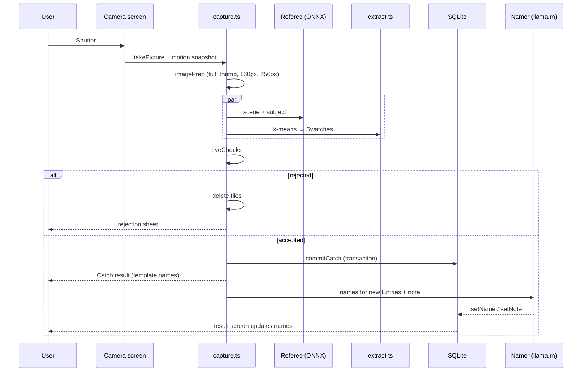
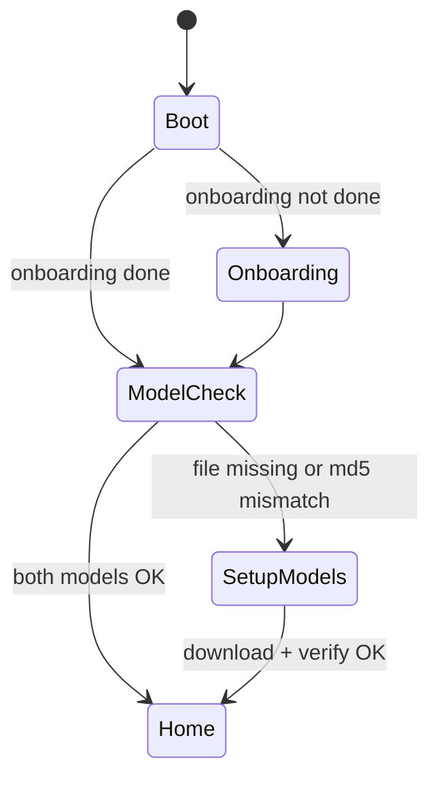

# PROCESS_FLOW.md — FarbeDex

## PURPOSE

Defines how FarbeDex behaves over time: user journeys, the catch sequence, state machines for app start, model setup, capture, naming and deletion, and error handling.
Concepts: `docs/PRD.md`. Algorithms: `docs/DEX_SPEC.md`. Modules and storage: `docs/TRD.md`. Screens: `docs/UI_DESIGN.md`.

## CONTEXT

- Everything runs on the phone. The only network use is the one-time model download.
- A Catch is either fully committed (photo + swatches + entry updates) or not saved at all.

## USER JOURNEYS

### J1 First launch

1. App opens → `/onboarding`: three cards ("Colour lives outside" · "Camera only — no uploads" · "AI runs on your phone"). Button **Start**.
2. `/setup-models`: shows two files with sizes and a total (≤ 300 MB), "Wi-Fi recommended", **Download**.
3. Progress bar with percentage per file → verifying → **Ready** → Home.
4. Onboarding is marked done in `settings`; it never shows again.

### J2 Catch colours

1. Home or any tab → center **Catch** button → `/catch` (full-screen camera, hint text "Point at something real").
2. User frames a scene and presses the shutter (haptic tick).
3. Processing overlay (~1–2 s): "Checking the scene… Reading colours…".
4. **Accepted:** `/catch-result/<id>`: "5 colours caught · 2 new!". Cards for each Swatch in Distribution order; new Entries flip from silhouette to colour; names appear when the Namer finishes (template name shown first, replaced in place). Buttons: **View photo**, **Catch again**.
5. **Rejected:** a bottom sheet with the reason and **Try again**:
   - SCREEN: "That's a screen. Go find the real thing."
   - PRINT: "That looks like a print or poster. Catch the real scene."
   - INDOOR: "Looks like you're inside. FarbeDex only counts colours caught outdoors."
   - NO_MOTION: "Hold the phone in your hand and try again."
   - STALE/ERROR: "Something went wrong. Try again."

### J3 Browse the FarbeDex

1. FarbeDex tab: header "FarbeDex · 37 / 151", filter chips (All · Caught · Missing · Rarity · Hue Family), search.
2. Grid of 151 cards. Tap a caught card → `/entry/<no>`; tap a missing card → missing-state detail (number, Hue Family, Rarity, silhouette, hint).
3. In Entry detail: prev/next arrows step through numbers; Neighbors and "Seen in" photos navigate onward.

### J4 Album and Photo Overview

1. Album tab: grid of thumbnails, each with a thin Distribution strip; newest first.
2. Tap → `/photo/<id>`: photo, Distribution bar, Swatch list (tap → Entry), subject, note, date, **Export**.
3. Long-press a thumbnail (or menu in Photo Overview) → **Delete catch** → confirm → recompute → back to Album.

### J5 Export a palette

1. Photo Overview → **Export** → sheet with tabs CSS · Tailwind · Tokens · Contrast.
2. **Copy** puts the text on the clipboard (toast "Copied"); **Share** opens the Android share sheet with a text file.

### J6 Field Notes and Rarity Guide

Home tiles open `/field-notes` (verified cards only) and `/rarity` (tiers explained, counts caught per tier).

## CATCH SEQUENCE

## STATE MACHINES

### App start gate

Model check compares size only at boot (fast); md5 is checked right after download.

### Model download (per file)

`Idle → Downloading(%) → Verifying → Ready`; `Downloading → Paused(network lost) → Downloading(resume)`; `Verifying → Failed(mismatch) → Idle` (file deleted, Retry restarts).

### Capture

`Framing → Capturing → Processing → (Accepted → Committed → Naming → Done) | Rejected`.
- Leaving the camera screen during Processing cancels and deletes files.
- Naming runs after Committed; leaving the result screen does not cancel it.

### Namer per Catch

`Queued → LoadingModel → Generating → Validating → (Saved | Retry → Generating → Validating → (Saved | Fallback))`. Fallback keeps template names and no note. Timeout (12 s) → Fallback.

### Entry

`Missing → Caught` (first commit with its Swatch) → stays Caught while `times_caught > 0` → `Missing (named)` after the last containing Catch is deleted → `Caught` again keeps its name.

## ERROR HANDLING

| Situation | Behaviour |
|---|---|
| Camera permission denied | Explain why, button to open app settings; no other import path offered |
| Model file missing/corrupt at boot | Route to `/setup-models` |
| ONNX session fails to load | Show "Referee unavailable"; captures are rejected with ERROR (no unverified Catches enter the FarbeDex) |
| llama.rn fails to load / times out | Template names, no note; toast "Naming offline — templates used"; Settings shows Namer status |
| Low storage during download | Error with required MB; Retry |
| DB transaction fails | Delete capture files, show ERROR, nothing saved |
| App backgrounded during Namer | Namer finishes if possible; otherwise names are retried on next app open for Entries with `name_source = 'TEMPLATE'` created in the last 10 minutes (MAY) |

## RELATED DOCUMENTS

`docs/PRD.md`, `docs/DEX_SPEC.md`, `docs/TRD.md`, `docs/UI_DESIGN.md`, `docs/MVP.md`.
