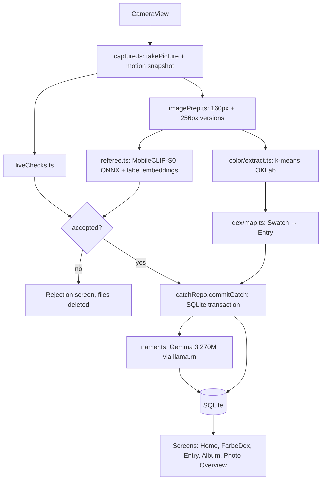

# TRD.md — FarbeDex

## PURPOSE

Defines HOW FarbeDex is implemented: stack, architecture, repository layout, app configuration, storage schema, model delivery and inference, live checks, the catch pipeline, navigation, performance budgets, testing and the register of details to verify.
Features and concepts: `docs/PRD.md`. Colour algorithms and thresholds: `docs/DEX_SPEC.md`. Priorities: `docs/MVP.md`. Flows and states: `docs/PROCESS_FLOW.md`. Screens: `docs/UI_DESIGN.md`.

## CONTEXT

- Single Android app built with Expo (React Native + TypeScript) as a **development build** (native modules: ONNX Runtime and llama.cpp). Expo Go is not supported.
- No backend. The network is used once, to download model files.
- Reference device: Dimensity 7050 (2× Cortex-A78 + 6× Cortex-A55), 8 GB RAM, arm64.

## STACK

| Concern | Package | Notes |
|---|---|---|
| Framework | `expo` (current stable SDK, VERIFY-1), `expo-dev-client`, TypeScript | Android only |
| Navigation | `expo-router` | File-based routes |
| Camera | `expo-camera` (`CameraView`) | Only image source in the app |
| Motion | `expo-sensors` (`DeviceMotion`) | Live checks |
| Image resize | `expo-image-manipulator` | Thumbnails, 160 px analysis image, 256 px Referee input |
| JPEG decode | `jpeg-js` | Pure JS |
| Colour maths | `culori` | OKLab/OKLCH conversions, gamut test |
| Files | `expo-file-system` | Private storage, resumable model download (VERIFY-6) |
| Database | `expo-sqlite` | Local data |
| Referee model runtime | `onnxruntime-react-native` | VERIFY-5 |
| Namer model runtime | `llama.rn` (llama.cpp binding) | VERIFY-4 |
| State | `zustand` | UI state; data via repositories |
| UI | `react-native-reanimated`, `react-native-gesture-handler`, `react-native-svg`, `expo-haptics`, `expo-clipboard`, `expo-sharing`, `expo-image` | |
| Fonts | `@expo-google-fonts/poppins`, `@expo-google-fonts/jetbrains-mono` | OFL licensed |
| Tests | `jest`, `jest-expo` | Pure-logic tests |

MUST NOT add: `expo-image-picker`, `expo-media-library`, `expo-document-picker`, `expo-location`, any analytics/crash/network SDK.

## ARCHITECTURE



## REPOSITORY LAYOUT

```text
.
├── CLAUDE.md  AGENT.md  BUILD_PROMPTS.md  README.md
├── docs/ PRD.md MVP.md DEX_SPEC.md TRD.md PROCESS_FLOW.md UI_DESIGN.md TASKS.md SETUP.md SUBMISSION.md
├── app.json  eas.json  package.json  tsconfig.json  babel.config.js  jest.config.js
├── app/                                  # expo-router routes
│   ├── _layout.tsx                       # fonts, DB init, model gate
│   ├── onboarding.tsx
│   ├── setup-models.tsx
│   ├── (tabs)/_layout.tsx                # bottom bar with center Catch button
│   ├── (tabs)/index.tsx                  # Home
│   ├── (tabs)/dex.tsx                    # FarbeDex grid
│   ├── (tabs)/album.tsx
│   ├── (tabs)/settings.tsx
│   ├── catch.tsx                         # camera (full screen, modal)
│   ├── catch-result/[id].tsx
│   ├── entry/[no].tsx
│   ├── photo/[id].tsx
│   ├── export/[id].tsx
│   ├── field-notes.tsx
│   └── rarity.tsx
├── src/
│   ├── color/ oklab.ts gamut.ts kmeans.ts extract.ts percent.ts contrast.ts prng.ts
│   ├── dex/ rules.ts entries.generated.ts map.ts rarity.ts neighbors.ts templateName.ts
│   ├── capture/ capture.ts motion.ts liveChecks.ts imagePrep.ts
│   ├── referee/ referee.ts preprocess.ts config.ts
│   ├── namer/ namer.ts prompt.ts validate.ts blocklist.ts
│   ├── models/ manifest.ts download.ts status.ts
│   ├── db/ schema.ts migrate.ts catchRepo.ts entryRepo.ts settingsRepo.ts
│   ├── export/ css.ts tailwind.ts tokens.ts
│   ├── ui/                               # design-system components (docs/UI_DESIGN.md)
│   └── store/ ui.ts
├── assets/
│   ├── labels/label-embeddings.json      # precomputed text embeddings (generated)
│   ├── field-notes.json
│   ├── brand/                            # original FarbeDex icon/splash (no franchise art)
├── scripts/
│   ├── build-dex.ts                      # writes src/dex/entries.generated.ts
│   └── build-label-embeddings.mjs        # laptop-only, Node + transformers.js
└── tests/
```

## APP CONFIGURATION

- `app.json`: `name: "FarbeDex"`, `slug: "farbedex"`, `platforms: ["android"]`, `android.package: "dev.farbedex.app"` (UNRESOLVED: team may choose another id), `orientation: "portrait"`, `userInterfaceStyle: "light"`.
- Plugins: `expo-router`, `expo-camera` (camera permission text: "FarbeDex uses the camera to catch colours from real scenes."), `expo-sqlite`, plus config plugins required by `onnxruntime-react-native` and `llama.rn` (VERIFY-4, VERIFY-5).
- Android permissions: `CAMERA` only. MUST NOT request storage/media/location permissions. Remove `RECORD_AUDIO` if a plugin adds it (`android.blockedPermissions`).
- Build only `arm64-v8a` to reduce APK size (VERIFY-8).
- `eas.json` profiles: `development` (`developmentClient: true`, `distribution: "internal"`, `android.buildType: "apk"`) for the dev-client APK installed without USB; `preview` (`android.buildType: "apk"`) for the release APK.
- Device workflow: dev-client APK + QR from `npx expo start --dev-client` (no USB/adb). Rebuild the APK only when native modules, config plugins or native config change (`docs/SETUP.md` §3).

## STORAGE

### Files (app-private `FileSystem.documentDirectory`)

```text
models/mobileclip_s0_vision.onnx
models/gemma-3-270m-it-Q4_K_M.gguf
catches/<catchId>.jpg          # full photo (max 2048 px longest side, JPEG 0.85)
thumbs/<catchId>.jpg           # 480 px longest side
```

### SQLite (`farbedex.db`), migrations via `PRAGMA user_version`

```sql
CREATE TABLE catches (
  id TEXT PRIMARY KEY,                 -- uuid
  created_at INTEGER NOT NULL,         -- epoch ms
  photo_path TEXT NOT NULL,
  thumb_path TEXT NOT NULL,
  width INTEGER NOT NULL, height INTEGER NOT NULL,
  subject_label TEXT, subject_score REAL,
  scene_label TEXT NOT NULL, scene_score REAL NOT NULL,
  other_pct REAL NOT NULL,
  note TEXT,                           -- Namer design note, nullable
  live_checks TEXT NOT NULL            -- JSON: LiveCheckResult
);

CREATE TABLE swatches (
  catch_id TEXT NOT NULL REFERENCES catches(id) ON DELETE CASCADE,
  entry_no INTEGER NOT NULL,
  hex TEXT NOT NULL,
  ok_l REAL NOT NULL, ok_c REAL NOT NULL, ok_h REAL NOT NULL,
  pct REAL NOT NULL,
  is_new INTEGER NOT NULL DEFAULT 0,
  rank INTEGER NOT NULL,
  PRIMARY KEY (catch_id, entry_no)
);
CREATE INDEX swatches_entry_idx ON swatches(entry_no);

CREATE TABLE entries (                 -- one row per Entry 1..151, created at first launch
  no INTEGER PRIMARY KEY,
  name TEXT,                           -- null until first caught; kept after uncatch
  name_source TEXT,                    -- 'GEMMA' | 'TEMPLATE'
  times_caught INTEGER NOT NULL DEFAULT 0,
  sum_pct REAL NOT NULL DEFAULT 0,
  first_caught_at INTEGER, first_catch_id TEXT,
  best_hex TEXT, best_distance REAL, best_catch_id TEXT
);

CREATE TABLE settings (key TEXT PRIMARY KEY, value TEXT NOT NULL);
```

Rules:
- `commitCatch` runs in one transaction: insert catch + swatches, update entries per `docs/DEX_SPEC.md` → CATCH COUNTING, set `is_new`.
- `deleteCatch` deletes the row (cascade), deletes files, and recomputes each affected Entry from remaining swatches (`times_caught`, `sum_pct`, first, best) in one transaction.
- Names are written by the Namer after commit (`entryRepo.setName(no, name, source)`); a later Namer failure never rolls back a Catch.

## MODEL DELIVERY

`src/models/manifest.ts`:

```ts
interface ModelFile { id: 'referee' | 'namer'; fileName: string; url: string; bytes: number; md5: string; license: string; }
```

- Hosting: GitHub Release `models-v1` of `github.com/Dronzer2code/FarbeDex`; asset URLs `https://github.com/Dronzer2code/FarbeDex/releases/download/models-v1/<fileName>`; sizes and md5 pinned in the manifest. Release notes and licence files: `release/models-v1/`. Upstream sources: VERIFY-2 (referee), VERIFY-7 (namer).
- Download with `File.createDownloadTask` into `models/*.part`, verify size + md5 (VERIFY-6), then rename. A retry resumes from the `.part` file's length (HTTP Range); no resume row in `settings` is needed.
- **Dev-only LAN model source** (replaces `adb push`; no env vars): when `__DEV__` is true, Settings, `/setup-models` and `/dev/ai-spike` show a "Dev model source" text field. Its value (e.g. `http://192.168.1.23:8099`) is stored in `settings` key `dev_model_base_url`. When set, the same downloader fetches `<base>/<fileName>` instead of `ModelFile.url` and verifies the same `bytes` + `md5`. The laptop serves the files with `npx serve .models -l 8099`. When `__DEV__` is false, the field is not rendered and `resolveModelUrl()` MUST return `ModelFile.url` unconditionally (unit-tested). Cleartext HTTP works only in debug builds (React Native's debug manifest allows it); release builds keep cleartext disabled.
- The model gate in `app/_layout.tsx`: if both files exist and match the manifest → normal app; otherwise → `/setup-models`.
- Budget: referee + namer ≤ 300 MB total. Actual: 253,115,424 + 22,876,479 = 275,991,903 B (276 MB).

## REFEREE (MobileCLIP-S0, ONNX)

- Model: MobileCLIP-S0 **image encoder only**, ONNX (quantized if available). Source, file name, input size, normalisation, output name and license: VERIFY-2. Fallback if the license disallows redistribution or ONNX fails: VERIFY-3.
- Session: one `InferenceSession` created lazily on first camera open, kept for the app's lifetime; execution provider CPU (XNNPACK if available, VERIFY-5).
- Preprocess (`referee/preprocess.ts`): from the 256 px image produced by `imagePrep.ts`: resize shortest side to model input size, center-crop square, RGB float32 CHW, normalise per the model's preprocessor config.
- Output: image embedding, L2-normalised.
- Label embeddings: `assets/labels/label-embeddings.json` produced on a laptop by `scripts/build-label-embeddings.mjs` using the **same model's text encoder** (transformers.js in Node). Each label stores `vec` (L2-normalised mean of its prompt embeddings) and `vecs` (one L2-normalised vector per prompt). Schema: `{ model, dims, logitScale, scene: Label[], subject: Label[] }`, `Label = { id, prompts: string[], vec: number[], vecs: number[][] }`. The phone never loads a text encoder.
- Model presets (`src/referee/config.ts` → `ACTIVE_REFEREE`): `mobileclip_s0_fp16` (default) and `tinyclip_8m_q8` (MIT fallback, VERIFY-3). Switching is JS-only.
- Scoring: a label's logit = `logitScale · max over its prompt vectors (imageVec · promptVec)` (decision 2026-10-10: averaging diverse prompts blurred the outdoor labels); softmax within each group.

Scene labels (group `scene`):

| id | Prompts |
|---|---|
| OUTDOOR_NATURE | "a photo of plants outdoors", "a photo of the sky outside", "a photo taken outdoors in nature", "a photo of trees and grass", "a photo of a landscape", "a photo of flowers in a garden", "a photo of a beach or a lake", "a close-up photo of moss on a stone outside", "a close-up photo of a leaf outdoors", "a close-up photo of tree bark", "a macro photo of an insect on a flower" |
| OUTDOOR_URBAN | "a photo of an outdoor street", "a photo of a building exterior", "a photo of a wall outside", "a photo of a city park", "a photo of a fence and a sidewalk" |
| INDOOR | "a photo of a room indoors", "a photo of furniture inside a house", "a photo of an office interior", "a photo of a kitchen" |
| SCREEN | "a photo of a computer monitor", "a photo of a phone screen", "a photo of a TV screen showing a picture", "a photo of a laptop screen on a desk", "a close-up photo of a screen with visible pixels", "a photo of a smartphone held in a hand showing a picture" |
| PRINT | "a photo of a printed photograph", "a photo of a poster on a wall", "a photo of a book page", "a photo of a magazine held in a hand", "a photo of a postcard on a table" |

(Prompts extended 2026-10-10 after the laptop check; the original three per label are kept.)

Accept when `argmax ∈ {OUTDOOR_NATURE, OUTDOOR_URBAN}` **and** `P(OUTDOOR_NATURE) + P(OUTDOOR_URBAN) ≥ 0.55`. Thresholds live in `referee/config.ts` and are calibrated in task T6 (10 screen shots, 10 outdoor shots; record results in `docs/TASKS.md`).

Subject labels (group `subject`, prompt template "a close-up photo of {label}"): sky, clouds, sunset sky, tree leaves, autumn leaves, grass, fern, moss, lichen, tree bark, flower, fruit, soil, rock, sand, water, wood, rusty metal, brick wall, painted wall. Stored subject = argmax label and its probability.

## NAMER (Gemma 3 270M IT, llama.rn)

- Model: Gemma 3 270M instruction-tuned, GGUF `Q4_K_M` (VERIFY-7: non-gated source, exact bytes, md5, Gemma Terms notice requirements).
- Context: `initLlama({ model: path, n_ctx: 1024, n_threads: 4, n_gpu_layers: 0, use_mlock: false })` (parameter names VERIFY-4). Loaded lazily when a Catch with new Entries commits; released when the app goes to background (`AppState`) to free memory.
- Call: one completion per Catch, chat messages formatted with the model's chat template, JSON-constrained output (JSON schema or GBNF grammar, VERIFY-4), `temperature 0.7`, `top_p 0.9`, `n_predict 220`.
- Output schema:

```json
{ "names": [ { "no": 67, "name": "Wet Moss Stone" } ], "note": "Use the moss green as the page background and the rust as a sparing accent for buttons." }
```

- Validation: `docs/DEX_SPEC.md` → NAMER OUTPUT RULES. Retry once with reasons; then templates.
- Timeout: 12 s per call; on timeout use templates and keep the Catch.

### Prompt (`namer/prompt.ts`)

System message:

```text
You name colours for a designer's colour collection and give short interface advice. Reply with JSON only.
```

User message (filled from data):

```text
Subject of the photo: {subjectLabel}
Palette (largest first): {hex pct%, ...}
New colours to name: [{"no": n, "hex": "#...", "family": "Green", "tone": "deep dusty"}, ...]
Names already used (do not reuse): {up to 40 most recent names}
Rules: each name 1-3 words, Title Case, evocative of the subject and the colour, no brand names, no numbers.
Then write "note": one sentence, at most 25 words, on how to use this palette in a user interface.
```

Two short few-shot examples (one moss scene, one sunset scene) are included before the real request.

`tone` = `[lightWord chromaWord]` from `docs/DEX_SPEC.md` → TEMPLATE NAMES, lowercased ("deep dusty", "pale", "vivid").

## LIVE CHECKS (`capture/liveChecks.ts`)

```ts
interface LiveCheckResult {
  motionOk: boolean; motionStd: number | null;       // null if sensor unavailable
  freshOk: boolean; captureToCommitMs: number;
  sceneOk: boolean; sceneLabel: string; sceneScore: number;
  burstOk?: boolean; burstDiff?: number;            // MAY
  accepted: boolean; reason?: 'NO_MOTION' | 'SCREEN' | 'PRINT' | 'INDOOR' | 'STALE' | 'ERROR';
}
```

- **Motion:** while the camera screen is open, `DeviceMotion` at 50 Hz fills a 1.5 s ring buffer. At shutter, take the samples from the last 800 ms and compute the standard deviation of the rotation-rate magnitude. Require `motionStd ≥ MOTION_MIN` (initial value 0.5 in the sensor's units; units VERIFY-9; calibrate in T5 with "phone on table" vs "hand-held"). If the sensor is unavailable, `motionOk = true`, `motionStd = null`.
- **Fresh:** the Catch must be committed within 120 s of capture, else discarded (`STALE`).
- **Scene:** Referee decision above. `reason` maps from the winning non-outdoor scene label.
- `accepted = motionOk && freshOk && sceneOk`.
- Rejected captures: delete all files for that capture; save nothing.

## CATCH PIPELINE (`capture/capture.ts`)

1. `takePictureAsync({ quality: 0.85, exif: false })` → cache file. Snapshot motion buffer.
2. `imagePrep`: write `catches/<id>.jpg` (max 2048 px), `thumbs/<id>.jpg` (480 px), and two in-memory analysis images: 160 px (extraction) and 256 px (Referee).
3. Run Referee and extraction concurrently (`Promise.all`).
4. Compute `LiveCheckResult`. If rejected → delete files → return rejection.
5. Map Swatches to Entries (`dex/map.ts`) → `catchRepo.commitCatch` → navigate to `/catch-result/<id>`.
6. If any `isNew` Swatch or note is wanted → run Namer → store names and note → result screen updates live.

Errors at any step: show "Something went wrong. Try again." and delete files; never leave partial rows.

## EXPORT (`src/export/`)

- CSS: `:root { --farbe-1: #xxxxxx; ... }` in Distribution order, with a comment line per variable `/* #067 Wet Moss Stone · 42.0% */`.
- Tailwind: `colors: { farbe: { 1: '#...', ... } }` snippet.
- Tokens JSON (W3C design tokens draft format): `{ "farbe": { "1": { "$type": "color", "$value": "#...", "$description": "..." } } }`.
- Contrast table: every Swatch pair's WCAG 2.x contrast ratio, marking AA (≥ 4.5) and AA-large (≥ 3).
- Copy via `expo-clipboard`; share as text via `expo-sharing` (text file in cache).

## NAVIGATION

| Route | Screen |
|---|---|
| `/onboarding` | Intro cards (first launch only) |
| `/setup-models` | Model download/verify |
| `/(tabs)` | Home · FarbeDex · [Catch button] · Album · Settings |
| `/catch` | Camera (full-screen modal) |
| `/catch-result/[id]` | Catch result |
| `/entry/[no]` | Entry detail |
| `/photo/[id]` | Photo Overview |
| `/export/[id]` | Export sheet |
| `/field-notes`, `/rarity` | Field Notes, Rarity Guide |

## PERFORMANCE BUDGETS (reference phone)

| Step | Budget |
|---|---|
| Camera open | < 1 s |
| Image prep | < 400 ms |
| Extraction | < 500 ms |
| Referee (warm session) | < 400 ms |
| Commit | < 100 ms |
| Namer (≤ 5 names + note) | < 6 s, async, never blocks the result screen |
| FarbeDex grid scroll | 60 fps with 151 cards (memoised cards, `FlashList` not required) |
| Peak RAM | < 900 MB |

## SECURITY AND PRIVACY

- Only permission: `CAMERA`. No network calls except model download URLs in the manifest.
- Photos and data never leave the app unless the user uses Export/share.
- Settings → "Delete all data" removes DB rows (keeps the 151 Entry rows reset) and catch files.

## TESTING (`tests/`, jest)

| Test | Asserts |
|---|---|
| oklab.test | conversions match `culori` reference values within 1e-6 |
| dex-reachable.test | all 151 Entries reachable on the 32³ sRGB grid |
| dex-rarity.test | tier counts 42/42/37/21/9 |
| dex-map.test | known colours map to expected numbers (e.g., pure grey L 0.6 → #004) |
| kmeans.test | deterministic output for a fixed synthetic image |
| extract.test | percentages sum to 100.0; < 3% goes to Other; ≤ 7 Swatches |
| counting.test | commit/delete update times_caught, first, best, uncatch keeps name |
| namer-validate.test | name rules, uniqueness, blocklist |
| export.test | CSS/Tailwind/tokens output for a fixed palette |
| no-import-path.test | forbidden packages absent; no `image/*` intent filter in `app.json` |
| no-franchise-terms.test | forbidden words (list in `CLAUDE.md` → HARD RULES, matched case-insensitively, with and without the accent) absent from every tracked file except `CLAUDE.md`, `docs/`, `AGENT.md`, `BUILD_PROMPTS.md` and this test file |

## VERIFY REGISTER

| ID | Item | How to resolve | Result |
|---|---|---|---|
| VERIFY-1 | Current Expo SDK; `expo-router`, `expo-camera` `CameraView` + `takePictureAsync` API | Expo docs | Team laptop reports Expo 57.0.9. npm registry (2026-10-10): `expo@57.0.9` exists and is an `expo` package version (its dependency `@expo/cli` is `^57.0.11`), so 57.0.9 = **Expo SDK 57**. dist-tags: `sdk-57` = `latest` = 57.0.27; `next` = 58.0.7 (not stable). Decision: scaffold on SDK 57 (`expo ~57.0.x`), the current stable SDK. Installed: expo 57.0.27, react-native 0.86.3, react 19.2.3, TypeScript 6.0, New Architecture on (required by llama.rn ≥ 0.10). `expo-router` 57.0.25: React Navigation is vendored; import `Tabs` and `BottomTabBarProps` from `expo-router/tabs`; routes stay in root `app/`. `expo-camera` 57.0.6: `CameraView` ref `takePictureAsync({ quality, exif, shutterSound, skipProcessing })` → `CameraCapturedPicture { uri, width, height }`; `useCameraPermissions()`; plugin options `recordAudioAndroid: false`, `barcodeScannerEnabled: false`, `microphonePermission: false`. |
| VERIFY-2 | MobileCLIP-S0 ONNX vision encoder: source repo (e.g., a Hugging Face ONNX conversion), file name, quantized size, input size, normalisation, output tensor name, `logit_scale`, and the weights' license permits redistribution in an app | Model card, config files, LICENSE | Source (sha256 match `fcbd153d…8472`): `huggingface.co/Xenova/mobileclip_s0` → `onnx/vision_model_quantized.onnx` (uint8 dynamic quant), 11,846,843 B. Input `pixel_values` float32 `[batch,3,256,256]`; output `image_embeds` float32 `[batch,512]` (not normalised; L2-normalise in app). Preprocessor: resize shortest edge 256 (bilinear), center crop 256, rescale 1/255, `do_normalize: false`. `logit_scale` = 100 (model card example). Laptop check (onnxruntime-node 1.24): runs, 106 ms. **License: weights are under Apple's "Machine Learning Research Model License" (github.com/apple/ml-mobileclip/LICENSE_MODELS): use/redistribution "exclusively for Research Purposes" = non-commercial scientific research; "does not include … product development or use in any commercial product". Redistribution requires shipping the agreement text + attribution notice.** Distribution in a public app APK is not clearly covered. **Team decision 2026-10-10: use MobileCLIP-S0 fp16** (smallest file, best results); every distribution ships the agreement copy + attribution notice (`release/models-v1/`), Settings → Licenses shows the attribution; FarbeDex is a non-commercial open-source project. TinyCLIP stays available as the MIT fallback preset. **Laptop check 2026-10-10:** the uint8 `vision_model_quantized.onnx` gives unusable embeddings (every image → SCREEN, random subjects); `onnx/vision_model_fp16.onnx` (22,876,479 B, md5 `81304dbb50d185466348b3ed59ab422a`, sha256 match) equals fp32 (cos ≈ 1.0) → the MobileCLIP preset uses fp16. Our TS preprocessing vs transformers.js processor: embedding cos 0.95–1.0. |
| VERIFY-3 | Fallback Referee if VERIFY-2 fails: a small permissively licensed ONNX image classifier (e.g., MobileNetV3) using ImageNet classes for screens (monitor, screen, television, laptop, cellular telephone) vs others; record choice and license | Model card | Candidate (not adopted yet): `huggingface.co/onnx-community/TinyCLIP-ViT-8M-16-Text-3M-YFCC15M-ONNX` → `onnx/model_quantized.onnx` (combined text+vision, 24,281,512 B), license MIT (upstream `wkcn/TinyCLIP-ViT-8M-16-Text-3M-YFCC15M`, MIT). Preprocessor: shortest edge 224 (bicubic), crop 224, rescale 1/255, CLIP mean/std. Keeps the zero-shot label-embedding design; total models 277 MB ≤ 300 MB. Weaker zero-shot accuracy than MobileCLIP-S0; must be re-calibrated in T6. **Implemented as preset `tinyclip_8m_q8`** (combined graph: dummy `input_ids`/`attention_mask` int64 + `pixel_values` 224, CLIP mean/std; output `image_embeds` 512; learned logit_scale 50.0). Laptop check on 9 stock images: gate 5/6 outdoor accepted, 3/3 non-outdoor rejected (same as MobileCLIP fp16), subject labels noticeably worse. |
| VERIFY-4 | `llama.rn`: Expo prebuild/config plugin support on Android, `initLlama` and `completion` parameter names, chat-template support, JSON schema or GBNF grammar support, bundled llama.cpp supports Gemma 3 | llama.rn README and source | Version **0.12.9** (latest stable; `latest` dist-tag points to 0.13.0-rc.7, not used). Requires New Architecture. Expo plugin `"llama.rn"` with options `{ enableOpenCLAndHexagon }` (we set `false`: OpenCL targets Adreno, reference phone is Mali; plugin otherwise only adds optional `uses-native-library` entries). Android uses prebuilt `jniLibs` (arm64-v8a, x86_64) downloaded by `postinstall` (on Windows run `npm install` from PowerShell so bsdtar is used; GNU tar from Git Bash fails). `initLlama({ model, n_ctx, n_threads, n_gpu_layers, use_mlock, use_mmap, … }, onProgress)` → `LlamaContext`; `context.completion({ messages, jinja, response_format: { type: 'json_schema', json_schema: { strict, schema } }, grammar, temperature, top_p, n_predict, stop }, onToken)` → `{ text, content, tokens_predicted, timings { prompt_ms, predicted_ms, predicted_per_second } }`; `context.release()`. Chat template from GGUF via Jinja (`jinja: true`). Bundled llama.cpp build 10256 (supports Gemma 3 incl. 270M). |
| VERIFY-5 | `onnxruntime-react-native`: Expo config plugin, Android arm64 build, tensor creation API, XNNPACK availability | Package README | Version **1.24.3**. Expo plugin `"onnxruntime-react-native"` adds `implementation project(':onnxruntime-react-native')` and requires a Groovy `app/build.gradle` (SDK 57 prebuild is Groovy ✓). Android pulls `com.microsoft.onnxruntime:onnxruntime-android:latest.integration`; ABIs follow `reactNativeArchitectures`. JSI host object installed via legacy `NativeModules.Onnxruntime.install()` (runs through the New Architecture interop layer; confirmed on device in T1). API: `InferenceSession.create(path, { executionProviders: ['xnnpack','cpu'], graphOptimizationLevel })`, `new Tensor('float32', data, dims)`, `session.run(feeds)`. XNNPACK EP is supported by the binding. Model path MUST be a plain filesystem path (no `file://`; the binding does not strip it). **Gradle 9 incompatibility:** its `android/build.gradle` uses the removed `VersionNumber` class (fails with "Could not get unknown property 'VersionNumber'" on SDK 57's Gradle 9.3.1). Fixed with `patches/onnxruntime-react-native+1.24.3.patch` (patch-package, `postinstall`); version pinned exactly so the patch applies. |
| VERIFY-6 | `expo-file-system` in the current SDK: resumable download API and md5 (or alternative hash) for ~250 MB files | Expo docs | expo-file-system **57.0.7**. Download: `File.createDownloadTask(url, file, { onProgress, signal })` → `DownloadTask` with `downloadAsync()`, `pause()/pauseAsync()`, `resumeAsync()`, `savable()`, `DownloadTask.fromSavable(state)`. Android source: `resumeData` = byte offset; failed transfers keep the partial file; resume sends `Range: bytes=<offset>-` (HTTP 200 → full restart). App design: download into `models/<file>.part`; on retry resume from the `.part` length (no settings row needed). md5: async `getInfoAsync(uri, { md5: true })` from `expo-file-system/legacy` (native, off the JS thread); the new API's `file.md5` / `file.info({ md5 })` are synchronous and would block the UI for ~250 MB. `File.move()` is async in SDK 57. |
| VERIFY-7 | Gemma 3 270M IT GGUF Q4_K_M: non-gated source, exact size, md5; Gemma Terms of Use notice requirements when redistributing | Hugging Face, ai.google.dev/gemma/terms | Source (sha256 match `b1baabd6…8e39`): `huggingface.co/unsloth/gemma-3-270m-it-GGUF` → `gemma-3-270m-it-Q4_K_M.gguf`, not gated, license `gemma`, base `google/gemma-3-270m-it`. 253,115,424 B, md5 `7d0214b04bf023c129d0b719ec435393`. Gemma Terms of Use §3.1 (fetched 2026-10-10 from ai.google.dev/gemma/terms): (a) include the §3.2 use restrictions (Prohibited Use Policy, ai.google.dev/gemma/prohibited_use_policy) as an enforceable provision in the terms governing use/distribution and notify recipients of them; (b) give all recipients a copy of the Agreement; (c) mark modified files (N/A, file unmodified); (d) every distribution must be accompanied by a "Notice" text file containing: "Gemma is provided under and subject to the Gemma Terms of Use found at ai.google.dev/gemma/terms". Plan: attach `NOTICE.txt` + the Terms to release `models-v1` and the APK release, show both in Settings → Licenses (T11), add a use-restriction clause to README/app licenses. |
| VERIFY-8 | Restricting the build to `arm64-v8a` (gradle property `reactNativeArchitectures` via config plugin or `expo-build-properties`) | Expo/React Native docs | `expo-build-properties` 57.0.22 option `android.buildArchs: ["arm64-v8a"]` → prebuild writes `reactNativeArchitectures=arm64-v8a` to `android/gradle.properties` (verified by local prebuild). Both llama.rn and onnxruntime-react-native read `reactNativeArchitectures` for their ABI filters. |
| VERIFY-9 | `DeviceMotion.rotationRate` units and sampling on Android | expo-sensors docs | expo-sensors 57.0.3: `rotationRate {alpha, beta, gamma}` in **deg/s** (Android source converts the gyroscope's rad/s with `Math.toDegrees`; alpha/beta/gamma = x/y/z), `null` until the first gyro event. `DeviceMotion.setUpdateInterval(ms)` (we use 20 ms = 50 Hz; > 200 Hz would need HIGH_SAMPLING_RATE_SENSORS), `isAvailableAsync()`, `addListener()`. The library manifest declares `ACTIVITY_RECOGNITION` (pedometer) → blocked in `app.json`; reading DeviceMotion needs no runtime permission. |

## RELATED DOCUMENTS

`docs/PRD.md`, `docs/DEX_SPEC.md`, `docs/MVP.md`, `docs/PROCESS_FLOW.md`, `docs/UI_DESIGN.md`, `docs/TASKS.md`.
